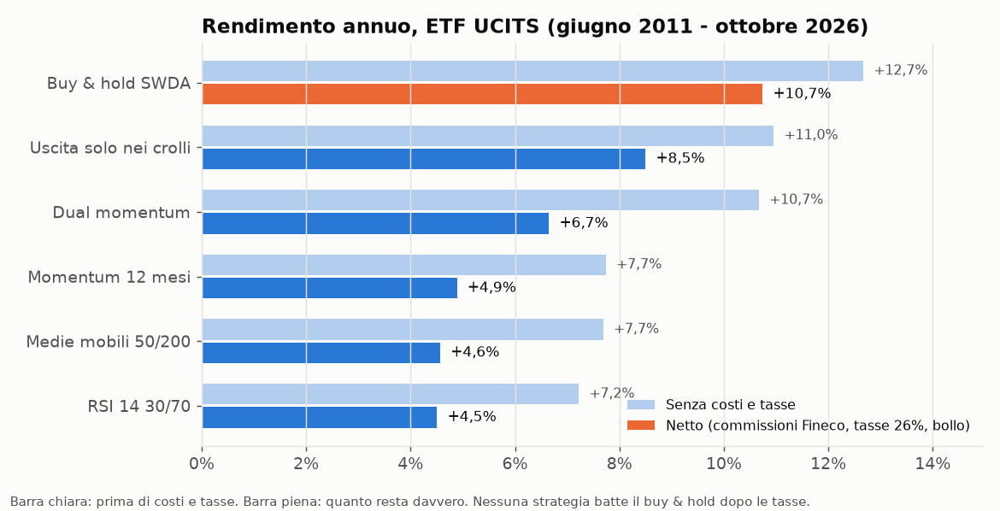
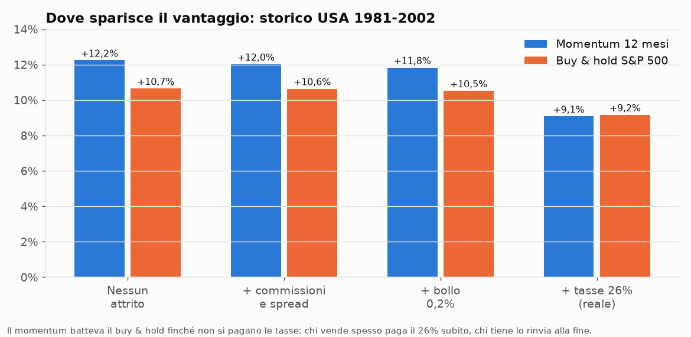
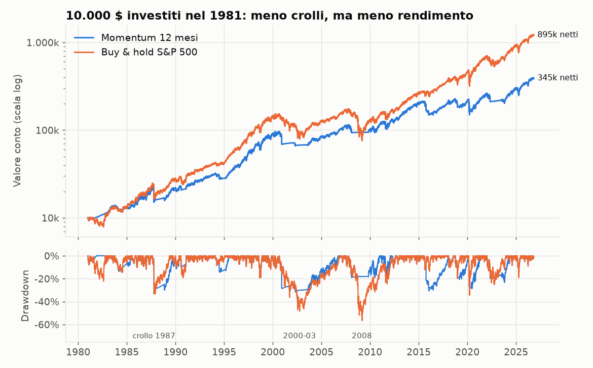
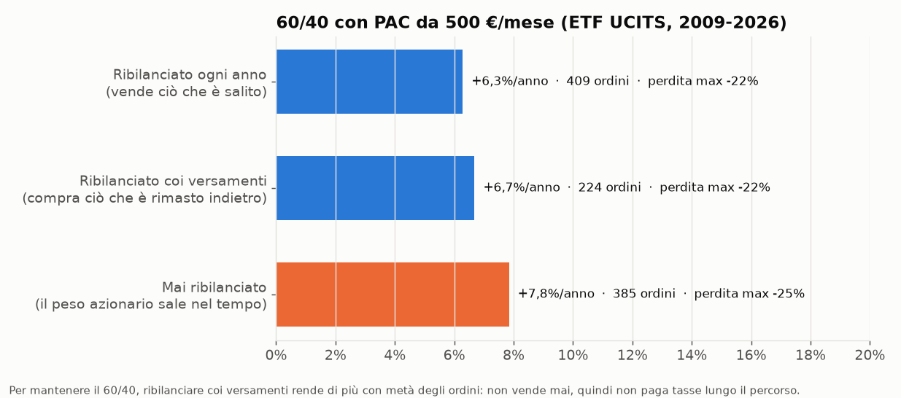
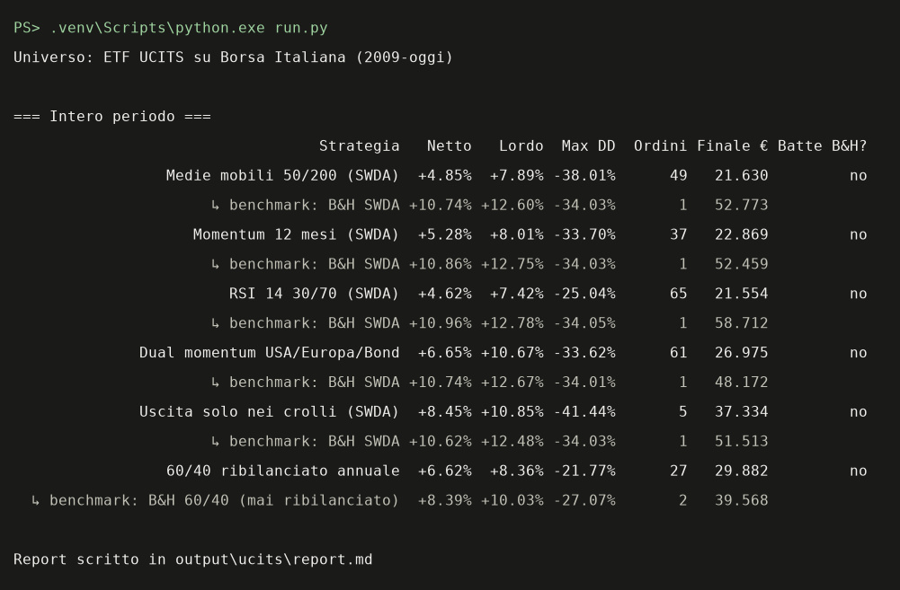

# App Investimenti — conviene fare trading con gli ETF in Italia?

Test di fattibilità in Python: scarica i prezzi di alcuni ETF, applica strategie di investimento
classiche (medie mobili, momentum, dual momentum, RSI, ribilanciamento) e le confronta con il
semplice **compra e tieni** (buy & hold), **dopo commissioni del broker, tasse italiane al 26% e bollo**.

> ⚠️ Progetto di studio. **Non è consulenza finanziaria**: i risultati passati non garantiscono quelli futuri.



## In breve: cosa è emerso

1. **Nessuna strategia batte il buy & hold dopo costi e tasse**: né sugli ETF UCITS (2009-2026), né
   sullo storico USA dal 1980, né ottimizzando i parametri (con verifica out-of-sample e walk-forward),
   né con un piano di accumulo (PAC) da 500 €/mese.
2. **Il colpevole sono le tasse, non le commissioni.** Prima delle tasse, nel 1981-2002 momentum e
   medie mobili battevano il buy & hold. Chi vende spesso paga il 26% subito su ogni guadagno; chi tiene
   lo paga una volta sola alla fine, e intanto quei soldi continuano a rendere. Le commissioni
   Fineco pesano circa 0,2 punti l'anno; le tasse circa 2,5.

   

3. **Le strategie di trend riducono davvero i crolli** (perdita massima -34% invece di -57% su 46 anni),
   ma lo pagano con 2-3 punti di rendimento in meno all'anno. È una scelta di tolleranza al rischio, non un modo per guadagnare di più.

   

4. **Se si vuole un portafoglio misto (es. 60% azioni / 40% obbligazioni), conviene ribilanciarlo con i versamenti**
   invece di vendere: rende di più del ribilanciamento annuale con circa metà degli ordini.

   

### Numeri principali (ETF UCITS, capitale unico 10.000 €)

| Strategia | Rendimento annuo netto | Perdita massima | Ordini | Benchmark |
|---|---|---|---|---|
| Medie mobili 50/200 | +4,9% | -38% | 49 | B&H SWDA +10,7% |
| Momentum 12 mesi | +5,3% | -34% | 37 | B&H SWDA +10,9% |
| RSI 14 30/70 | +4,6% | -25% | 65 | B&H SWDA +11,0% |
| Dual momentum USA/Europa/Bond | +6,7% | -34% | 61 | B&H SWDA +10,7% |
| Uscita solo nei crolli | +8,5% | -41% | 5 | B&H SWDA +10,6% |
| 60/40 ribilanciato annuale | +6,6% | -22% | 27 | B&H 60/40 +8,4% |

Ogni strategia è confrontata con il buy & hold a partire dallo stesso giorno. Report completi in `output/` dopo l'esecuzione.

## Avvio

Serve Python 3.11+ (testato con 3.13).

```powershell
python -m venv .venv
.\.venv\Scripts\python.exe -m pip install -r requirements.txt

.\.venv\Scripts\python.exe run.py                              # ETF UCITS, capitale unico
.\.venv\Scripts\python.exe run.py --universo usa               # storico lungo USA (1980-oggi)
.\.venv\Scripts\python.exe run.py --mensile 500                # con PAC da 500 €/mese
.\.venv\Scripts\python.exe optimize.py [--universo usa]        # ottimizzazione + walk-forward
.\.venv\Scripts\python.exe make_charts.py                      # rigenera le immagini di questo README
```

Al primo avvio i prezzi vengono scaricati da Yahoo Finance e salvati in `data/` (cache); `--refresh` li riscarica.
I risultati finiscono in `output/<universo>/`: `report.md` (tabelle), `curva_*.png` (andamento e drawdown),
`ordini_*.csv` (ogni singolo ordine con commissioni e tasse).



## Come funziona

| File | Cosa fa |
|---|---|
| `investlab/config.py` | universi di ETF, commissioni, tasse, date di separazione dei dati |
| `investlab/data.py` | download prezzi, cache, controllo qualità dati (salti anomali, prezzi fermi) |
| `investlab/strategies.py` | le strategie: producono "pesi obiettivo" giorno per giorno |
| `investlab/engine.py` | simulazione del conto: ordini, costi, costo medio, tasse, bollo, versamenti |
| `investlab/metrics.py` | rendimento annuo (IRR), volatilità, drawdown, Sharpe |
| `run.py` | esegue tutte le strategie e scrive il report |
| `optimize.py` | ottimizzazione dei parametri con verifica out-of-sample e walk-forward |
| `make_charts.py` | genera le immagini del README |

Il motore è scritto da zero invece di usare librerie come vectorbt o backtrader: la fiscalità italiana
(costo medio, minusvalenze ETF non compensabili, bollo) è il cuore del test e doveva essere trasparente.

### Ipotesi di realismo

- **Esecuzione**: la decisione si prende sul prezzo di chiusura, l'ordine si esegue alla chiusura del giorno dopo (nessuna "sbirciata al futuro").
- **Commissioni Fineco**: 0,19% dell'ordine (min 2,95 €, max 19 €) + spread 0,10%. Ordini sotto 200 € non vengono eseguiti.
- **Tasse**: 26% sulla plusvalenza a ogni vendita, sul costo medio ponderato (come fa il broker in regime amministrato).
  Le minusvalenze da ETF **non** compensano plusvalenze da ETF: nel report sono "Minus perse".
  Semplificazione prudente: 26% anche sugli ETF obbligazionari (in realtà la quota in titoli di Stato è al 12,5%).
- **Bollo**: 0,2% annuo sul valore dei titoli.
- **Liquidazione finale**: alla fine si vende tutto, così anche il buy & hold paga le sue tasse e il confronto è alla pari.
- **Fuori mercato**: quando una strategia esce, compra un ETF monetario (XEON), non resta a 0%.
- **PAC**: il versamento arriva il primo giorno di borsa del mese. Il benchmark lo investe secondo i pesi iniziali;
  il "ribilanciamento coi versamenti" lo usa per comprare solo ciò che è rimasto sotto il peso obiettivo.

### Universi di test (`--universo`)

| Universo | Strumenti | Periodo | A cosa serve |
|---|---|---|---|
| `ucits` (default) | SWDA, CSSPX, SMEA, XGLE, XEON | 2009-oggi | ETF ad accumulazione acquistabili su Borsa Italiana |
| `usa` | VFINX (S&P 500), VEURX (Europa), VBMFX (bond), T-bill 3 mesi | 1980-oggi | solo studio: include 1987, 2000-2003, 2008 |

Per SWDA e SMEA i prezzi storici vengono da Xetra/Amsterdam (stesso fondo, stesso ISIN, in EUR): a Milano nel
2011-2012 erano poco scambiati e il prezzo restava fermo per giorni. Nell'universo `usa` si usano prezzi
rettificati per i dividendi; costi e tasse restano quelli italiani, come se esistessero ETF equivalenti.

### Le metriche

- **Rendimento annuo netto**: rendimento medio annuo di ciò che resta in tasca dopo tutto (IRR: tiene conto di quando
  sono stati versati i soldi; senza PAC coincide con il CAGR). È il numero più importante.
- **Rendimento senza costi/tasse**: lo stesso, in un mondo senza attriti. La differenza è il costo dell'operatività.
- **Max drawdown**: la perdita peggiore dal massimo precedente (-34% = 10.000 € diventati 6.600 €). Calcolato escludendo i versamenti.
- **Volatilità** e **Sharpe**: quanto oscilla il valore in un anno e quanto rendimento si ottiene per unità di oscillazione.

### Contro l'overfitting

I parametri in `run.py` sono quelli "da manuale" (50/200 giorni, 12 mesi, RSI 14 con soglie 30/70), non ottimizzati.
`optimize.py` prova griglie di parametri in due modi:

- **In-sample → out-of-sample**: sceglie sui dati fino al 2018 (USA: 2002), giudica solo sui dati successivi.
- **Walk-forward**: a inizio di ogni anno sceglie i parametri usando solo gli anni precedenti e li usa per quell'anno.
  È la stima più onesta di cosa si sarebbe ottenuto davvero.

## Limiti

- Dati gratuiti (Yahoo Finance): possibili errori, controllati ma non eliminabili del tutto.
- 16 anni di storico UCITS, quasi tutti in mercato rialzista; lo storico USA allunga il test ma non è investibile dall'Italia.
- Fiscalità semplificata (aliquota unica 26%, nessun utilizzo di minusvalenze da altri strumenti).
- Le strategie testate sono poche e classiche: il risultato non esclude che altre regole funzionino.

## Riferimenti

[vectorbt](https://github.com/polakowo/vectorbt) · [backtrader](https://github.com/mementum/backtrader) ·
[LEAN](https://github.com/QuantConnect/Lean) · G. Antonacci, *Dual Momentum Investing* · E. Chan, *Quantitative Trading*

## Licenza

[MIT](LICENSE)
