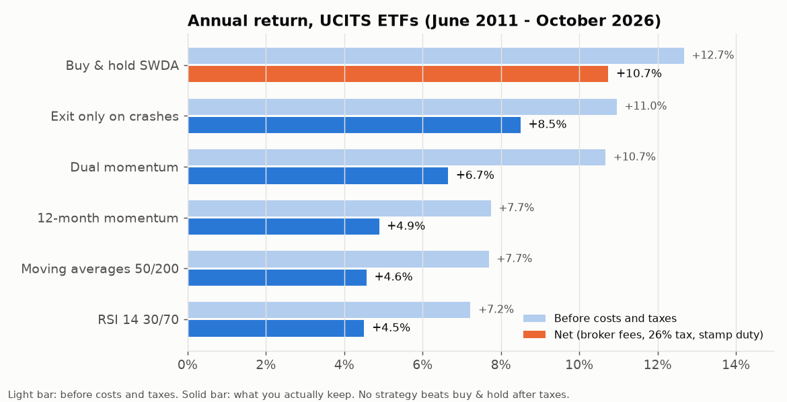
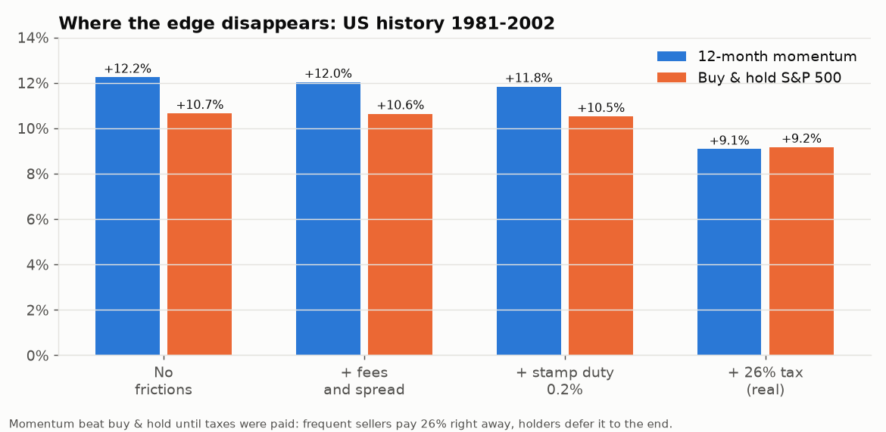
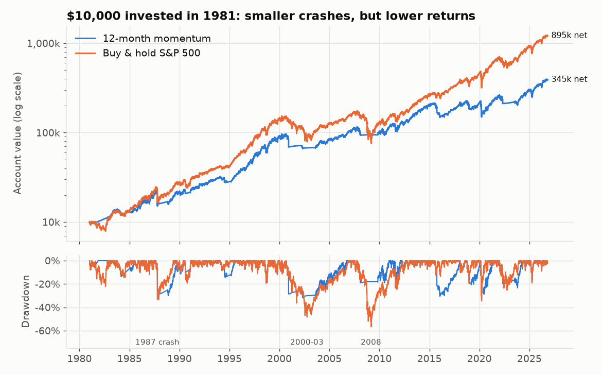
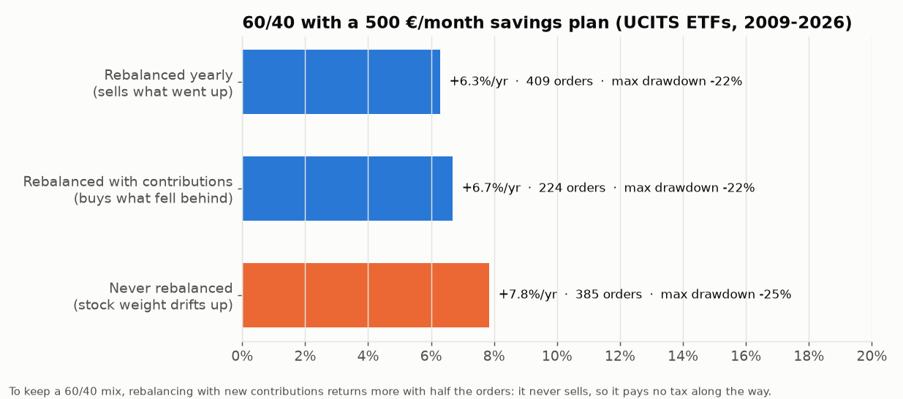
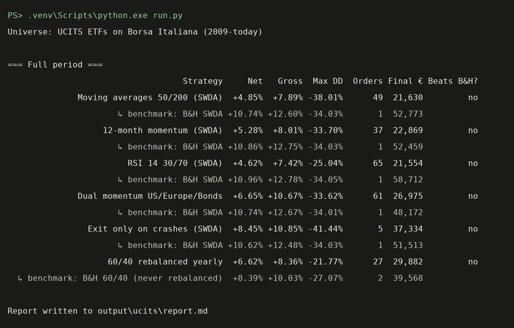

# Invest Lab — does trading ETFs pay off for an Italian investor?

**English** · [Italiano](README.it.md)

A Python feasibility study: it downloads ETF prices, applies classic investment strategies
(moving averages, momentum, dual momentum, RSI, rebalancing) and compares them with plain
**buy & hold**, **after broker fees, Italian capital gains tax (26%) and stamp duty**.

> ⚠️ Study project. **This is not financial advice**: past performance does not guarantee future results.

The program itself prints its reports in Italian; the console screenshot below is translated for readability.



## Key findings

1. **No strategy beats buy & hold after costs and taxes**: not on UCITS ETFs (2009-2026), not on
   US history since 1980, not after parameter optimization (with out-of-sample and walk-forward checks),
   and not with a 500 €/month savings plan.
2. **Taxes are the culprit, not fees.** Before taxes, momentum and moving averages beat buy & hold
   in 1981-2002. A strategy that sells often pays 26% on every gain right away; a buy & hold investor
   pays once at the end, and the deferred tax keeps compounding in the meantime. Broker fees cost about
   0.2 percentage points a year; taxes about 2.5.

   

3. **Trend-following really does cut crashes** (max drawdown -34% instead of -57% over 46 years),
   but pays for it with 2-3 points of return per year. It is a choice about risk tolerance, not a way to earn more.

   

4. **If you want a mixed portfolio (e.g. 60% stocks / 40% bonds), rebalance it with new contributions**
   instead of selling: it returns more than yearly rebalancing, with about half the orders.

   

### Main figures (UCITS ETFs, single 10,000 € investment)

| Strategy | Net annual return | Max drawdown | Orders | Benchmark |
|---|---|---|---|---|
| Moving average crossover 50/200 | +4.9% | -38% | 49 | B&H SWDA +10.7% |
| 12-month momentum | +5.3% | -34% | 37 | B&H SWDA +10.9% |
| RSI 14 30/70 | +4.6% | -25% | 65 | B&H SWDA +11.0% |
| Dual momentum US/Europe/Bonds | +6.7% | -34% | 61 | B&H SWDA +10.7% |
| Exit only on crashes | +8.5% | -41% | 5 | B&H SWDA +10.6% |
| 60/40 rebalanced yearly | +6.6% | -22% | 27 | B&H 60/40 +8.4% |

Each strategy is compared with buy & hold starting on the same day. Full reports are written to `output/` when you run it.

## Getting started

Requires Python 3.11+ (tested with 3.13).

```powershell
python -m venv .venv
.\.venv\Scripts\python.exe -m pip install -r requirements.txt

.\.venv\Scripts\python.exe run.py                              # UCITS ETFs, single investment
.\.venv\Scripts\python.exe run.py --universo usa               # long US history (1980-today)
.\.venv\Scripts\python.exe run.py --mensile 500                # with a 500 €/month savings plan
.\.venv\Scripts\python.exe optimize.py [--universo usa]        # optimization + walk-forward
.\.venv\Scripts\python.exe make_charts.py                      # regenerate the images in this README
```

On the first run prices are downloaded from Yahoo Finance and cached in `data/`; `--refresh` downloads them again.
Results go to `output/<universe>/`: `report.md` (tables), `curva_*.png` (equity curve and drawdown),
`ordini_*.csv` (every single order with its fees and taxes).



## How it works

| File | What it does |
|---|---|
| `investlab/config.py` | ETF universes, fees, taxes, data split dates |
| `investlab/data.py` | price download, cache, data quality checks (abnormal jumps, stale prices) |
| `investlab/strategies.py` | the strategies: each one produces daily "target weights" |
| `investlab/engine.py` | account simulation: orders, fees, average cost, taxes, stamp duty, contributions |
| `investlab/metrics.py` | annual return (IRR), volatility, drawdown, Sharpe |
| `run.py` | runs every strategy and writes the report |
| `optimize.py` | parameter optimization with out-of-sample and walk-forward validation |
| `make_charts.py` | generates the README images |

The engine is written from scratch instead of using libraries such as vectorbt or backtrader: Italian taxation
(average cost basis, non-offsettable ETF losses, stamp duty) is the core of the test and had to be transparent.

### Realism assumptions

- **Execution**: decisions use the closing price; orders fill at the next day's close (no look-ahead).
- **Fees (Fineco)**: 0.19% of the order (min 2.95 €, max 19 €) + 0.10% bid-ask spread. Orders below 200 € are skipped.
- **Taxes**: 26% on the gain at every sale, on the weighted average cost (as the broker does under the Italian "regime amministrato").
  Losses on ETFs **cannot** offset gains on ETFs: the report lists them as "Minus perse" (wasted losses).
  Conservative simplification: 26% also on bond ETFs (in reality the government-bond share is taxed at 12.5%).
- **Stamp duty**: 0.2% per year on the value of the holdings.
- **Final liquidation**: everything is sold at the end, so buy & hold pays its taxes too and the comparison is fair.
- **Out of the market**: when a strategy exits, it buys a money-market ETF (XEON) instead of sitting at 0%.
- **Savings plan**: the contribution arrives on the first trading day of the month. The benchmark invests it at the
  initial weights; "rebalancing with contributions" uses it to buy only what is below its target weight.

### Test universes (`--universo`)

| Universe | Instruments | Period | Purpose |
|---|---|---|---|
| `ucits` (default) | SWDA, CSSPX, SMEA, XGLE, XEON | 2009-today | accumulating ETFs available on Borsa Italiana |
| `usa` | VFINX (S&P 500), VEURX (Europe), VBMFX (bonds), 3-month T-bills | 1980-today | study only: covers 1987, 2000-2003, 2008 |

For SWDA and SMEA historical prices come from Xetra/Amsterdam (same fund, same ISIN, in EUR): in Milan they
traded so thinly in 2011-2012 that the price often stayed flat for days. The `usa` universe uses dividend-adjusted
prices; fees and taxes stay Italian, as if equivalent ETFs existed.

### Metrics

- **Net annual return**: average yearly return of what you actually keep (IRR: it accounts for when money was
  paid in; without contributions it equals CAGR). This is the number that matters.
- **Return before costs/taxes**: the same, in a frictionless world. The gap is the cost of trading.
- **Max drawdown**: the worst fall from a previous peak (-34% = 10,000 € became 6,600 €). Contributions are excluded.
- **Volatility** and **Sharpe**: how much the value swings in a year, and how much return you get per unit of swing.

### Guarding against overfitting

The parameters in `run.py` are the textbook ones (50/200 days, 12 months, RSI 14 with 30/70 thresholds), not optimized.
`optimize.py` searches parameter grids in two ways:

- **In-sample → out-of-sample**: picks parameters on data up to 2018 (US: 2002) and judges them only on later data.
- **Walk-forward**: at the start of each year, picks parameters using only the previous years and uses them for that year.
  This is the most honest estimate of what you would actually have achieved.

## Limitations

- Free data (Yahoo Finance): errors are possible; they are checked but cannot be ruled out entirely.
- 16 years of UCITS history, almost all in a bull market; the US history extends the test but is not investable from Italy.
- Simplified taxation (flat 26%, losses never used against other instruments).
- Only a few classic strategies are tested: the result does not rule out that other rules might work.

## References

[vectorbt](https://github.com/polakowo/vectorbt) · [backtrader](https://github.com/mementum/backtrader) ·
[LEAN](https://github.com/QuantConnect/Lean) · G. Antonacci, *Dual Momentum Investing* · E. Chan, *Quantitative Trading*

## License

[MIT](LICENSE)
